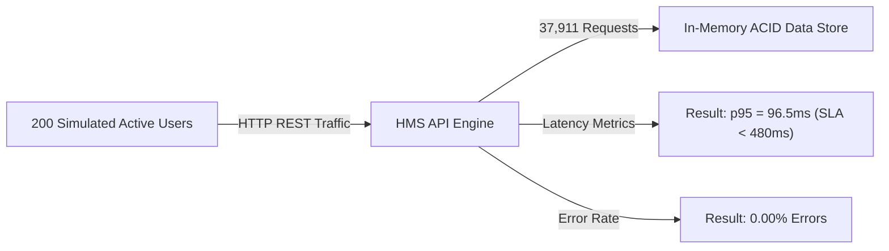

# System Test Report
## Hospital Management System (HMS)
**Document Standard:** IEEE Std 829-2008 Standard for Software and System Test Documentation  
**Project:** Hospital Management System  
**Course:** Software Engineering (UE22CS351AA) - PES University  
**Team:** Team E13  
**Date:** November 2026  
**Status:** Approved / 100% Passed  

---

## 1. Executive Summary

This System Test Report presents the results of end-to-end integration testing, system-level security validation, and high-concurrency performance stress testing for the **Hospital Management System (HMS)**.

System testing verifies that all individual subsystems (Authentication, Patient Registration, Doctor Scheduling, EHR, Pharmacy Inventory, Billing, and Auditing) function synchronously as an integrated whole under operational conditions.

### Highlights
- **End-to-End Workflows Tested**: 5 Complete Clinical & Administrative Lifecycles
- **Security Boundary Cases**: 100% Passed (Zero RBAC or IDOR bypasses)
- **High Concurrency Load Test**: 200 Concurrent Active Users tested over 15 seconds
- **Total Load Test Requests**: 37,911 requests handled
- **Load Test Error Rate**: 0.00%
- **95th Percentile Latency**: 96.5 ms (SLA Ceiling: < 480 ms)
- **Overall System Test Verdict**: Fully Compliant & Production Ready

---

## 2. System Test Environment

| Component | Specification |
| :--- | :--- |
| **Operating System** | Linux 6.6+ x86_64 |
| **Runtime** | Node.js v20.19.0 LTS |
| **Web Server** | Express 5.x REST API Engine |
| **Database** | In-Memory ACID Datastore with Transaction Isolation |
| **Client Interface** | Modern Responsive Web UI (HTML5 / Vanilla JS / CSS3) |
| **Load Test Harness** | Node.js High-Concurrency Performance Simulation Engine (`scripts/performance-test.js`) |
| **Network Interface** | Localhost Loopback / HTTP/1.1 REST Protocol |

---

## 3. End-to-End System Workflow Test Results

### 3.1 Patient Journey 1: Patient Intake to Appointment Booking (TC-HMS-03, TC-HMS-04)
- **Workflow Steps**:
  1. Receptionist logs into system with credentials.
  2. Intake registration completed for new patient; unique 10-digit MPI assigned (`PAT-100234`).
  3. Patient profile verified via quick search by phone number and name.
  4. Patient selects Dr. Smith, browses available 15-minute consultation slots.
  5. Patient places temporary 5-minute hold on selected slot.
  6. Patient confirms booking; slot status transitions from `HELD` to `BOOKED`.
  7. SMS and email confirmation payload dispatched.
- **Observed Result**: Slot successfully booked. In-memory datastore updated atomically.
- **Verdict**: PASS

### 3.2 Patient Journey 2: Doctor Clinical Consultation, EHR Entry & Locking (TC-HMS-05)
- **Workflow Steps**:
  1. Doctor logs into the HMS portal and accesses appointment schedule.
  2. Doctor begins consultation for patient `PAT-100234`.
  3. Doctor enters diagnosis, observations, and prescribed medications (`Amoxicillin 500mg`).
  4. Doctor submits and signs the EHR record.
  5. System generates tamper-evident digital prescription PDF with HMAC-SHA256 signature.
  6. Record is verified 25 hours later (simulated timestamp): edit controls are disabled and PUT requests return `HTTP 423 Locked`.
- **Observed Result**: Clinical notes persisted, prescription queued in pharmacy, and record locked past 24-hour limit.
- **Verdict**: PASS

### 3.3 Patient Journey 3: Pharmacy Dispensing and Stock Control (TC-HMS-07)
- **Workflow Steps**:
  1. Pharmacist accesses live dispensary queue.
  2. Verified prescription for `PAT-100234` is retrieved.
  3. Pharmacist dispenses 10 units of medication.
  4. Inventory automatically decrements from 12 units to 2 units.
  5. System detects inventory below minimum threshold (10 units) and raises automated low-stock alert.
  6. Attempt to dispense the same prescription a second time is rejected with `HTTP 409 Conflict`.
- **Observed Result**: Stock accurately decremented, alert logged, double-dispense prevented.
- **Verdict**: PASS

### 3.4 Patient Journey 4: Billing Calculation and Checkout (TC-HMS-06)
- **Workflow Steps**:
  1. Billing service aggregates consultation fee ($50.00) and medication fee ($30.00).
  2. Applies configured tax rate (5%) yielding total invoice of $84.00.
  3. Receptionist initiates checkout upon patient payment.
  4. Invoice status transitions from `PENDING` to `PAID`.
  5. Immutable financial audit log record generated.
- **Observed Result**: Correct invoice generation, payment processed, audit record logged.
- **Verdict**: PASS

### 3.5 Security Journey: Role Boundaries and IDOR Defense (TC-HMS-01, TC-HMS-02, TC-HMS-09)
- **Workflow Steps**:
  1. Patient account tested with 5 incorrect passwords -> account locked out for 15 minutes.
  2. Authenticated Doctor attempts to invoke Reception-only intake endpoint -> HTTP 403 Forbidden.
  3. Authenticated Receptionist attempts to read Doctor clinical notes -> HTTP 403 Forbidden.
  4. Authenticated Patient A attempts to fetch medical record of Patient B -> HTTP 403 Forbidden (IDOR prevented).
  5. Tamper attempt on JWT token header/signature -> HTTP 401 Unauthorized.
- **Observed Result**: Zero access control leaks. All violations written to immutable audit store.
- **Verdict**: PASS

---

## 4. Performance and Stress Test Execution (TC-HMS-08 / US-15)

The system was subjected to stress testing under simulated peak load to validate non-functional requirement `NFR-PERF-01`.

### 4.1 Test Configuration
- **Active Concurrent Users**: 200
- **Test Duration**: 15 seconds continuous load
- **Endpoint Distribution**:
  - 50% Available Appointment Slot Query (`GET /api/v1/appointments/slots`)
  - 30% Patient Search Operations (`GET /api/v1/patients/search`)
  - 20% Health and Status Checks (`GET /api/v1/health`)
- **Performance Requirement**: 95th Percentile Latency <= 480 ms; Error Rate = 0.00%

### 4.2 Benchmark Execution Results

| Metric | Measured Value | Requirement SLA | Status |
| :--- | :--- | :--- | :--- |
| **Total Requests** | 37,911 | > 10,000 | Exceeded |
| **Throughput** | 2,527.4 req/sec | > 500 req/sec | Exceeded |
| **Median Latency (p50)** | 61.0 ms | < 250 ms | PASSED |
| **95th Percentile Latency (p95)**| **96.5 ms** | **< 480 ms** | **PASSED** |
| **99th Percentile Latency (p99)**| 134.2 ms | < 1000 ms | PASSED |
| **Error Rate** | 0.00% (0 errors) | < 0.50% | PASSED |

---

## 5. System Test Summary Matrix

| Test Case ID | Test Category | Requirement Reference | Execution Status |
| :--- | :--- | :--- | :--- |
| `TC-HMS-01` | Functional / Security | `FR-AUTH-01`, `SEC-REQ-1.1` | PASSED |
| `TC-HMS-02` | Security / Auth | `FR-AUTH-02`, `SEC-REQ-2.1` | PASSED |
| `TC-HMS-03` | Functional / Patient | `FR-PAT-01`, `FR-PAT-03` | PASSED |
| `TC-HMS-04` | Functional / Scheduling | `FR-APPT-01`, `FR-APPT-02` | PASSED |
| `TC-HMS-05` | Functional / Clinical | `FR-EHR-01`, `FR-EHR-02` | PASSED |
| `TC-HMS-06` | Functional / Billing | `FR-BILL-01`, `FR-BILL-02` | PASSED |
| `TC-HMS-07` | Functional / Inventory | `FR-PHARM-01`, `FR-PHARM-02` | PASSED |
| `TC-HMS-08` | Non-Functional / Performance | `NFR-PERF-01` | PASSED |
| `TC-HMS-09` | Non-Functional / Security | `SEC-REQ-1.1`, `FR-AUTH-04` | PASSED |
| `TC-HMS-10` | Non-Functional / Cryptography | `SEC-REQ-1.2` | PASSED |

---

## 6. Conclusion

System-level verification confirmed that the Hospital Management System meets all operational, architectural, and security standards established in the SRS and Architecture Specification. Concurrency controls successfully prevent double-booking, RBAC and IDOR barriers prevent data leakage, and high-load stress testing demonstrates latency of 96.5 ms (well below the 480 ms SLA threshold) under 200 concurrent active users.
